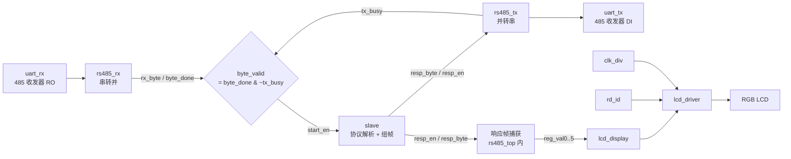

# RS485 / Modbus RTU 从机 + RGB LCD 状态显示（Verilog）

基于 FPGA（Artix-7 开发板）的 **Modbus RTU 从机示例**：串口接收请求 → 解析 0x03 读保持寄存器 → 组帧回送 → 同时把寄存器值实时显示在 RGB LCD 上。附带一个 **主站组帧发送**（`master_send`）和 **CRC16-Modbus** 计算模块，方便做点对点联调。

- 通信：RS485 半双工，115200-8N1，收发器方向由硬件自动控制（DE/RE 自翻转），顶层只需 `uart_rx` / `uart_tx` 两根线
- 协议：Modbus RTU，从机地址 `0x10`，功能码 `0x03`，寄存器基址 `0x1000`
- 显示：RGB LCD（DE 模式，RGB888），左上角 COE 图片 + 右侧 6 行 4 位数值

> **关于显示模块**：本工程只有一个 `lcd_display.v`，它是**经 AI 重构优化后的版本**——把「6 行 × 4 位 = 24 段重复判断」压缩成「一次算行号 + 一次算列号 + 一次取 nibble + 一次查字模」。
> 如果一眼看不懂，直接跳到 [第 6 节](#6-显示模块-lcd_displayvai-优化版)，那里按「区域 → 行 → 位 → 字模位」四步拆开讲，并给了一个具体像素的完整推导。

---

## 目录

- [1. 项目简介](#1-项目简介)
- [2. 功能特性](#2-功能特性)
- [3. 系统结构与模块划分](#3-系统结构与模块划分)
- [4. Modbus 通信流程](#4-modbus-通信流程)
- [5. CRC16-Modbus](#5-crc16-modbus)
- [6. 显示模块 `lcd_display.v`（AI 优化版）](#6-显示模块-lcd_displayvai-优化版)
- [7. 参数与寄存器速查](#7-参数与寄存器速查)
- [8. 快速上手（Vivado）](#8-快速上手vivado)
- [9. 联调与验证](#9-联调与验证)
- [10. 已知限制与注意事项](#10-已知限制与注意事项)
- [11. 致谢与许可](#11-致谢与许可)

---

## 1. 项目简介

| 项目 | 内容 |
| --- | --- |
| 语言 | Verilog-2001 |
| 开发环境 | Vivado（依赖 Block Memory Generator IP：`blk_mem_gen_1`） |
| 系统时钟 | 50 MHz |
| 串口 | 115200 bps，8N1，无校验 |
| 物理层 | RS485 半双工，自动方向控制（无需 DE 引脚） |
| 协议角色 | Modbus RTU **从机**（Slave #0x10），3 号功能码（读保持寄存器） |
| 显示 | RGB LCD 800×480（多分辨率自适应），图片 + 十六进制数值 |

设计刻意做得「扁平」：一条串口收、一条串口发、一个协议状态机、一条显示链，没有总线、没有 DMA，方便逐层阅读。

---

## 2. 功能特性

- **Modbus 03 读寄存器**：从机地址 `0x10`，起始地址 `0x1000`，单次最多读 6 个寄存器（1~6 可配）。
- **帧边界靠空闲间隔判定**：不依赖 CRC 或固定长度，连续 4 个字节时间（≈347 µs）无新字节即认为一帧结束，天然适配 RTU 的 `t3.5` 静默规则。
- **地址/功能码预过滤**：首字节不是本机地址、或功能码不是 0x03 时进入 `SILENT` 状态丢弃整帧，不占缓存、不回包。
- **硬件自动方向 + 回环屏蔽**：`byte_valid = byte_done & ~tx_busy`，发送期间不把自己的响应当成新请求。
- **CRC16-Modbus**：独立模块，字节级流水（每喂 1 字节输出 1 次校验值），可用于主站组帧。
- **`master_send`（主站参考实现）**：收到一帧后用 4 字节前导静默 + 原数据 + CRC + 4 字节尾部静默重新发出，演示完整的 RTU 帧时序。
- **LCD 实时显示寄存器**：从响应帧中抓取 6 个 16 位寄存器值，按 4 位十六进制显示，无需上位机辅助。
- **多分辨率自适应**：`rd_id` 读屏 ID，`clk_div`/`lcd_driver` 自动切换 480×272 / 800×480 / 1024×600 / 1280×800 时序。

---

## 3. 系统结构与模块划分



### 模块清单

| 文件 | 模块 | 作用 |
| --- | --- | --- |
| `rs485_top.v` | `rs485_top` | **当前顶层**：串口收/发 + 从机 + LCD 链路，并抓取响应帧送给显示模块 |
| `rs485_top--.v` | `rs485_top` | **旧版顶层备份**：只有串口 + LCD，无寄存器抓取；与上一行同名，**二选一编译** |
| `rs485_rx.v` | `rs485_rx` | UART 接收：3 级同步 + 起始位检测 + 中点采样 + 字节完成脉冲 |
| `rs485_tx.v` | `rs485_tx` | UART 发送：按 `tx_cnt` 查表输出 10 bit，`tx_busy` 反馈 |
| `slave.v` | `slave` | Modbus 从机状态机：地址/功能码校验、4 字节间隔判帧、组响应帧、逐字节发送 |
| `master_send.v` | `master_send` | 主站参考：缓存一帧、算 CRC、按 RTU 时序重发（**顶层未例化**） |
| `crc16_modbus.v` | `crc16_modbus` | CRC16-Modbus 位级计算（6 状态机，8 bit 循环） |
| `rd_id.v` | `rd_id` | 上电读一次屏 ID（`M2/G7/R7`） |
| `clk_div.v` | `clk_div` | 按屏 ID 产生 12.5 / 25 / 50 MHz 像素时钟 |
| `lcd_driver.v` | `lcd_driver` | RGB DE 模式行场时序，输出 `pixel_xpos/ypos`、DE/HS/VS/CLK/BL/RST |
| `lcd_display.v` | `lcd_display` | **AI 优化版**（本工程唯一的显示模块）：COE 图片 + 6 行 4 位十六进制数值 |
| `lcd_top.v` | `lcd_rgb_colorbar` | 早期彩条/模板工程遗留，**端口与当前 `rd_id`/`lcd_display` 不匹配，勿加入工程** |

### 顶层信号

| 信号 | 方向 | 说明 |
| --- | --- | --- |
| `sys_clk` | in | 50 MHz |
| `sys_rst_n` | in | 复位，低有效 |
| `uart_rx` | in | 接 485 收发器 `RO` |
| `uart_tx` | out | 接 485 收发器 `DI`（DE 由硬件自动控制） |
| `lcd_de / lcd_hs / lcd_vs / lcd_bl / lcd_clk / lcd_rst` | out | LCD 控制 |
| `lcd_rgb[23:0]` | inout | RGB888，兼作屏 ID 读取线 |

---

## 4. Modbus 通信流程

### 4.1 帧格式

请求（读保持寄存器，功能码 0x03）：

| 字节 | 0 | 1 | 2 | 3 | 4 | 5 | 6 | 7 |
| --- | --- | --- | --- | --- | --- | --- | --- | --- |
| 含义 | 从机地址 | 0x03 | 起始地址 Hi | 起始地址 Lo | 寄存器数 Hi | 寄存器数 Lo | CRC Lo | CRC Hi |

响应（本设计，**不含 CRC**）：

| 字节 | 0 | 1 | 2 | 3… |
| --- | --- | --- | --- | --- |
| 含义 | 从机地址 | 0x03 | 字节数 n = 2×数量 | 寄存器数据（每寄存器 2 字节，高字节在前） |

### 4.2 示例（读 0x1000 起 3 个寄存器）

```
请求 : 10 03 10 00 00 03      （CRC 0x4A02，标准线上顺序应为 02 4A）
响应 : 10 03 06 12 34 67 89 11 22    （本设计实际发出的帧，无 CRC）
```

### 4.3 从机状态机

```
IDLE ──首字节──> ADDRESS_CODE ──地址匹配──> FUNCTION_CODE ──功能=03──> DATA_DISTRICT
                      │ 地址不匹配                │ 功能码不支持
                      └──────────> SILENT <───────┘
DATA_DISTRICT ──4字节空闲──> FRAME_CHECK ──帧合法──> BUILD_FRAME ──> SEND ──发完──> IDLE
```

- `DATA_DISTRICT` 负责收满整帧（含 CRC 字节，但**不校验 CRC**）；
- `FRAME_CHECK` 判据：`addr_ok && func_ok && (wptr >= 6) && (1 <= qty <= 6) && (idx + qty <= 16)`；
- `BUILD_FRAME` 一次组好整帧放入 `tx_buffer`：地址、功能码、字节数、寄存器值（高字节在前）；
- `SEND` 用 `send_phase` 两拍节拍：0 拍装载 `tx_data` 并拉高 `tx_en`，1 拍等 `tx_done` 再取下一字节；
- `SILENT` 用于丢弃非法帧，等 4 字节空闲后回 `IDLE`。

### 4.4 "进入状态"检测技巧

状态机里需要"进入某状态的第一个时钟"做一次初始化，这里用：

```verilog
wire [8:0] enter = cur_st & ~prev_st;   // 独热码相与，即位"刚进入"
```

比在每个时序块里写 `if (cnt == 0)` 更干净，也不依赖计数值。这也是本模块一段值得借鉴的写法。

### 4.5 回环与总线冲突

板载 485 收发器为**自动方向**（发送时 DE 自动拉高，同时 RO 仍可能输出本机数据）。因此：

```verilog
wire byte_valid = byte_done & (~tx_busy);   // 发送期间不接收
```

用 `tx_busy` 屏蔽发送窗口内的接收字节，避免从机把自己的响应当成新请求。

### 4.6 `master_send`（主站参考，未在顶层例化）

| 状态 | 动作 |
| --- | --- |
| `ST_RECV` | 收字节入 `frame_mem`，同时喂 CRC；空闲 4 字节判定帧结束 |
| `ST_START` | 4 字节时长前导静默 |
| `ST_STRB` / `ST_WAIT` | 逐字节发送：`rptr < len` 发原数据，`rptr == len` 发 CRC 高字节，再发 CRC 低字节 |
| `ST_STOP` | 4 字节时长尾部静默，清指针回 `ST_RECV` |

实测效果：收到 `10 03 10 00 00 03` 后发出 `10 03 10 00 00 03 4A 02`（注意字节序问题见 5.3）。

---

## 5. CRC16-Modbus

### 5.1 算法

多项式 `0xA001`（`x^16 + x^15 + x^2 + 1` 的反射形式），初值 `0xFFFF`，无最终异或：

```verilog
crc_reg[7:0] <= crc_temp ^ crc_reg[7:0];   // 字节异或
crc_reg      <= crc_reg >> 1;              // 右移
crc_reg      <= crc_reg ^ 16'hA001;        // 若移出位为 1 则异或多项式
```

`crc16_modbus` 用 6 个状态（`IDLE / CRC_XOR / CRC_CIRCLE / CRG_0REG / CRG_1REG / CRC_DONE`）把上面的"每字节 8 次循环"展开成时钟节拍，**每个时钟处理 1 bit**，一个字节 8 拍完成。

### 5.2 接口

| 信号 | 说明 |
| --- | --- |
| `sclr` | 同步清零，回到 `0xFFFF`（新帧首字节时拉高） |
| `din / din_vld` | 输入字节 + 单周期有效 |
| `crc_dout` | 16 位校验值 |
| `crc_dout_vld` | 每喂完 1 字节脉冲 1 次 |

### 5.3 字节序：代码与注释不一致

实测（标准算法）：

| 帧 | CRC 值 |
| --- | --- |
| `10 03 10 00 00 03` | `0x4A02` |
| `10 03 06 12 34 67 89 11 22` | `0x4411` |

- 注释写"已交换高低字节，输出 `16'h4A02`，线上顺序 `4A 02`"；
- 但代码是 `crc_dout <= {crc_reg[15:8], crc_reg[7:0]}`，**并未交换**，输出就等于 `crc_reg`；
- `master_send` 先发 `crc_r[15:8]` 再发 `crc_r[7:0]`，即**高字节在前**；
- 而标准 Modbus RTU 规定 **CRC 低字节先发**（应发 `02 4A`）。

若要与标准主站（Modbus Poll / 组态软件 / 下位机库）互通，二选一：

```verilog
// 方案 A：在 crc16_modbus 里真正交换字节
crc_dout <= {crc_reg[7:0], crc_reg[15:8]};
// 方案 B：保持 crc_dout，在发送端口换序
tx_data = crc_r[7:0];   // 先发低字节
tx_data = crc_r[15:8];  // 再发高字节
```

---

## 6. 显示模块 `lcd_display.v`（AI 优化版）

> **本工程只有一个 `lcd_display.v`，没有 `--` 备份版本。**
> 该模块是**经 AI 重构优化后**的实现：相对于「6 行 × 4 位 = 24 段各自判断区域」的传统写法，它把绘制压缩成固定四步，代码只有 153 行。
> 阅读顺序建议：先看 6.1 知道屏幕上有什么，再看 6.2 了解为什么能写这么短，最后用 6.3 的具体像素例子对上号。

### 6.1 显示内容与坐标

`lcd_display.v` 只做两件事：**贴一张图 + 打 6 行十六进制数字**。

| 区域 | 参数 | 位置 | 尺寸 |
| --- | --- | --- | --- |
| COE 图片 | `PIC_X_START / PIC_Y_START / PIC_WIDTH / PIC_HEIGHT` | (10, 10) | 167 × 134 |
| 数值区 | `VALUE_X_START / VALUE_Y_START / VALUE_Y_STEP` | x=200，y=15 | 4 位 × 8×16 / 行，行距 19 |
| 数字字模 | `char[0..9]` | — | 8×16，`0`~`9` |

```
┌────────────────────────────────────────────┐
│ ┌──────────────┐   1234   ← reg_val0       │
│ │              │   6789   ← reg_val1       │
│ │  COE 图片     │   1122   ← reg_val2       │
│ │  167×134     │   0000   ← reg_val3       │
│ │              │   0000   ← reg_val4       │
│ └──────────────┘   0000   ← reg_val5       │
└────────────────────────────────────────────┘
```

每个数值按**十六进制 nibble** 显示：`16'h1234 → "1234"`；nibble 为 `A`~`F` 时该位留白（不支持显示）。

### 6.2 为什么要写成「四步」

传统写法是 24 段并列的 `if`：每一行、每一位都重新比较 `pixel_ypos` 是否落在该行、`pixel_xpos` 是否落在该位，然后各自换算位索引。功能正确，但比较器重复 24 份、优先级链极长，改版式要复制粘贴。

AI 优化版把「行/位」信息**先算成两个小索引**，后面所有判断都复用它们：

| 步骤 | 算出什么 | 代码 |
| --- | --- | --- |
| ① 区域 | 当前像素是否在数值区 | `in_val_region = x_in_val && y_in_digit` |
| ② 行号 | `line_idx` 0~5，以及行内 Y 偏移 | 5 级比较器 + `y_offset = pixel_ypos - line_y_start` |
| ③ 位号 | `digit_idx` 0~3、数字内 X 偏移 | `x_offset[5:3]` / `x_offset[2:0]`（位选代替除法取模） |
| ④ 取位 | 该位是哪个 nibble、字模的哪一位 | `reg_valN[(3-digit_idx)*4 +: 4]` + `char[cur_digit][...]` |

绘制主链只剩 3 级优先：**图片 > 数字 > 背景**。

### 6.3 逐行拆解（含一个像素的完整推导）

```verilog
// ② 行号：一次比较链，落到 6 行中的一行
reg [2:0] line_idx;
always @(*) begin
    line_idx = 3'd0;
    if      (pixel_ypos >= VALUE_Y_START + 5*VALUE_Y_STEP) line_idx = 3'd5;
    else if (pixel_ypos >= VALUE_Y_START + 4*VALUE_Y_STEP) line_idx = 3'd4;
    else if (pixel_ypos >= VALUE_Y_START + 3*VALUE_Y_STEP) line_idx = 3'd3;
    else if (pixel_ypos >= VALUE_Y_START + 2*VALUE_Y_STEP) line_idx = 3'd2;
    else if (pixel_ypos >= VALUE_Y_START + 1*VALUE_Y_STEP) line_idx = 3'd1;
    else                                                   line_idx = 3'd0;
end
wire [10:0] line_y_start = VALUE_Y_START + line_idx * VALUE_Y_STEP;
wire        y_in_digit   = (pixel_ypos - line_y_start) < DIGIT_H;  // 行距 19，字高 16，中间 3 像素留白
```

```verilog
// ③ 位号：x/8 与 x%8 都用位选，综合出来就是线，不是除法器
wire [2:0] digit_idx  = x_offset[5:3];   // 第几个数字 0~3
wire [2:0] x_in_digit = x_offset[2:0];   // 数字内第几列 0~7
```

```verilog
// ④ 取 nibble：digit_idx=0 取 [15:12]，=3 取 [3:0]
case(line_idx)
    3'd0: cur_digit = reg_val0[(3-digit_idx)*4 +: 4];
    3'd1: cur_digit = reg_val1[(3-digit_idx)*4 +: 4];
    ...
endcase

// 字模 128bit = 16 行 × 8 列，每行 1 字节，MSB 在上、MSB 在左
if (char[cur_digit][(15 - y_offset[3:0]) * 8 + (7 - x_in_digit)])
    pixel_data <= CHAR_COLOR;   // 该位为 1 → 黑色
else
    pixel_data <= BACK_COLOR;   // 该位为 0 → 白色
```

**举个例子**：假设 `reg_val0 = 16'h1234`，当前扫描到像素 `(205, 20)`。

| 计算 | 结果 |
| --- | --- |
| `y_offset = 20 - 15` | `5`，`5 < 16` → 在数字高度内 |
| `line_idx` | `0`（20 < 34） |
| `x_offset = 205 - 200` | `5` |
| `digit_idx = 5[5:3]` | `0` → 第 1 个数字 |
| `x_in_digit = 5[2:0]` | `5` → 数字内第 5 列 |
| `cur_digit = reg_val0[(3-0)*4 +: 4]` | `reg_val0[15:12] = 4'h1` |
| 字模位 | `(15-5)*8 + (7-5) = 82` → `char[1][82]` |

所以这个像素显示的是「1234」里的第一个字符 `1`，位置由 `char[1]` 第 82 位决定黑/白。把它和 6.1 的坐标表对照，就能把任意像素反推回「哪一行、第几位、哪个数字」。

### 6.4 改版式 / 扩展

| 想做什么 | 改哪里 |
| --- | --- |
| 数值整体右移 / 下移 | `VALUE_X_START` / `VALUE_Y_START` |
| 行距变大 / 变小 | `VALUE_Y_STEP`（注意要 ≥ `DIGIT_H`） |
| 数字放大（8×16 → 16×32） | `DIGIT_W` / `DIGIT_H` 与 `char` 字模同步改，位索引公式同步改 |
| 显示 5 位、6 位十六进制 | `NUM_DIGITS` + `x_in_val` 范围 + nibble 取法 |
| 多显示几行 | `NUM_VALUES` + `line_idx` 比较链补一条 + 新增 `reg_valN` 输入 |
| 显示十进制而不是十六进制 | 上游加 `binary2bcd`，把 `cur_digit` 改成按 BCD 取 4 bit |
| 想显示 `A`~`F` | 补 6 个字模，去掉 `cur_digit <= 9` 判断，索引改成 `case` 查表 |

> 改参数后**最省事的验证方式**：改一个坐标、下一个比特流、看屏幕上数字挪动的位置，比逐行读代码更快建立直觉。

### 6.5 `lcd_top.v` 说明

`lcd_top.v` 里的模块叫 `lcd_rgb_colorbar`，是早期彩条/模板工程的遗留：它按 `.led_rgb`、`.lcd_plck`、`.h_disp` 等**旧端口名**例化 `rd_id` 与 `lcd_display`，与当前版本端口不匹配，**不要加入工程**。需要单独验证屏幕时，建议用 `rs485_top--.v`。

---

## 7. 参数与寄存器速查

### 顶层 `rs485_top`

| 参数 | 默认值 | 说明 |
| --- | --- | --- |
| `UART_BPS` | 115200 | 波特率 |
| `CLK_FREQ` | 50 000 000 | 系统时钟，必须与实际一致 |

### `slave`

| 参数 | 默认值 | 说明 |
| --- | --- | --- |
| `SLAVE_ADDR` | `8'h10` | 从机地址 |
| `FRAME_MAX` | 16 | 接收缓存深度 |
| `REG_DEPTH` | 16 | 寄存器个数 |
| `QTY_MAX` | 6 | 单次最多读几个寄存器 |

| 地址 | 初值 |
| --- | --- |
| `0x1000` | `0x1234` |
| `0x1001` | `0x6789` |
| `0x1002` | `0x1122` |
| `0x1003`~`0x100F` | `0x0000` |

> 地址解析只取低 4 位（`d_idx = d_start[3:0]`），因此实际可访问范围是 `0x1000`~`0x100F`。

### 帧间隔

`BAUD_CNT_MAX = 50e6 / 115200 = 434`，`UART_FRAME_BIT = 10`，`SEND_BYTE_NUM = 4`：

```
FOUR_BYTE_TIME = 434 × 10 × 4 = 17 360 个时钟 ≈ 347 µs
```

---

## 8. 快速上手（Vivado）

### 8.1 新建工程

1. Create Project，选开发板对应器件。
2. 加入 **Design Sources**：
   - `rs485_top.v`（顶层）
   - `rs485_rx.v`、`rs485_tx.v`、`slave.v`、`crc16_modbus.v`
   - `lcd_display.v`、`lcd_driver.v`、`rd_id.v`、`clk_div.v`
   - 可选：`master_send.v`（当前顶层未例化）
3. **不要加入**：`rs485_top--.v`（与顶层同名）、`lcd_top.v`（端口不匹配）。

### 8.2 生成 `blk_mem_gen_1`

`lcd_display.v` 通过 `blk_mem_gen_1` 读取一张 24 位色的 COE 图片，需自行创建：

| 项 | 设置 |
| --- | --- |
| IP | Block Memory Generator |
| Memory Type | Single Port ROM |
| Port A Width | 24 |
| Port A Depth | 32768（15 位地址） |
| Enable | 勾选 `ena` |
| Init File | 你的 `.coe`（图片按行扫描顺序排列，尺寸建议 167×134） |

封装名保持 `blk_mem_gen_1`。不想用图片时，可把 `pixel_data <= rom_rd_data` 那一分支删掉，只保留数值区。

### 8.3 引脚约束模板

```tcl
# ---- 时钟与复位 ----
set_property -dict {PACKAGE_PIN <PIN_SYS_CLK> IOSTANDARD LVCMOS33} [get_ports sys_clk]
create_clock -name sys_clk -period 20.000 [get_ports sys_clk]
set_property -dict {PACKAGE_PIN <PIN_RST_N>   IOSTANDARD LVCMOS33} [get_ports sys_rst_n]

# ---- RS485 ----
set_property -dict {PACKAGE_PIN <PIN_485_RX> IOSTANDARD LVCMOS33} [get_ports uart_rx]
set_property -dict {PACKAGE_PIN <PIN_485_TX> IOSTANDARD LVCMOS33} [get_ports uart_tx]

# ---- RGB LCD ----
set_property -dict {PACKAGE_PIN <PIN_LCD_CLK> IOSTANDARD LVCMOS33} [get_ports lcd_clk]
set_property -dict {PACKAGE_PIN <PIN_LCD_DE>  IOSTANDARD LVCMOS33} [get_ports lcd_de]
set_property -dict {PACKAGE_PIN <PIN_LCD_HS>  IOSTANDARD LVCMOS33} [get_ports lcd_hs]
set_property -dict {PACKAGE_PIN <PIN_LCD_VS>  IOSTANDARD LVCMOS33} [get_ports lcd_vs]
set_property -dict {PACKAGE_PIN <PIN_LCD_BL>  IOSTANDARD LVCMOS33} [get_ports lcd_bl]
set_property -dict {PACKAGE_PIN <PIN_LCD_RST> IOSTANDARD LVCMOS33} [get_ports lcd_rst]
set_property -dict {PACKAGE_PIN <PIN_R0> IOSTANDARD LVCMOS33} [get_ports {lcd_rgb[0]}]
# … R1~R7 / G0~G7 / B0~B7 依次约束 lcd_rgb[23:0]
```

> `lcd_rgb` 为 `inout`：读屏 ID 时作输入、显示时作输出，Vivado 自动推断三态。

---

## 9. 联调与验证

### 9.1 硬件连接

- USB-RS485 转换器 `A` 接板卡 `A`、`B` 接 `B`（必要时互换）；
- 确认终端电阻/偏置电阻状态，长线时建议 120 Ω 终端；
- LCD 排线接好，确认背光与屏 ID 电阻配置。

### 9.2 用串口助手（HEX 模式）发请求

```
10 03 10 00 00 03 02 4A      ← 标准 CRC 低字节在前
```

板卡应返回（6 字节数据）：

```
10 03 06 12 34 67 89 11 22
```

同时 LCD 右侧 6 行显示：

```
1234
6789
1122
0000
0000
0000
```

### 9.3 用 Modbus Poll 等标准主站

本设计响应帧**不含 CRC**（`slave` 的 `BUILD_FRAME` 只组 addr/func/count/data），标准主站会判定 CRC 错误。两种做法：

1. 在 `BUILD_FRAME` 里追加 CRC16（可直接复用 `crc16_modbus`，注意 5.3 的字节序）；
2. 或改用 `master_send` 那条通路做"回环转发"演示。

### 9.4 现象排查

| 现象 | 可能原因 |
| --- | --- |
| 完全无回复 | 波特率/时钟频率参数与实际不符；A/B 接反；收发器 DE 未自动使能 |
| 回复乱码 | `CLK_FREQ` 与板载时钟不一致（434 个时钟算错） |
| 首帧丢、后续正常 | 上电瞬间总线毛刺被当成起始位；可加接收超时复位 |
| LCD 全白 | 屏 ID 读错 → 像素时钟/时序不匹配；检查 `M2/G7/R7` 配置 |
| LCD 数值不更新 | 响应未被捕获：检查 `resp_en` 是否在发送时有效、`tx_busy` 屏蔽是否过宽 |
| 数值显示为空白位 | 该 nibble 为 `A`~`F`，本设计只画 `0`~`9` |

---

## 10. 已知限制与注意事项

1. **顶层同名二选一**：`rs485_top.v` ↔ `rs485_top--.v`，同时编译会报模块重复定义。
2. **`lcd_top.v` 已过期**：模块名 `lcd_rgb_colorbar`，端口与当前 `rd_id`/`lcd_display` 不匹配，勿加入工程。
3. **`slave.v` 的注释为 ANSI（GBK / CP936）编码**：Windows 下的 Vivado、Notepad++ 可正常显示，但 GitHub 网页按 UTF-8 解析，会显示成乱码；若要网页正常显示，请另存一份 UTF-8 副本。
4. **响应帧无 CRC**：不符合标准 Modbus RTU，标准主站会报 CRC 错（见 9.3）。
5. **CRC 字节序与注释不符**：`crc_dout` 实际未交换高低字节，发送顺序为高字节在前（见 5.3）。
6. **`master_send` 未例化**：当前顶层走的是 `slave` 应答通路，`master_send` 是可选的第二套演示。
7. **不支持写寄存器**：`WRITE_REG_VALUE (0x10)` 仅定义未实现，`CRC` 状态为空。
8. **寄存器地址只取低 4 位**：`0x1000`~`0x100F`，越界地址会被 `qty_ok` 过滤。
9. **`slave.v` 用 `initial` 初始化 `reg_mem`**：Xilinx 综合支持，移植到部分 FPGA 需改为复位初始化。
10. **`rs485_rx` 为单点中点采样**：抗噪一般；高干扰现场建议改成 16 倍过采样 + 三取二判决。
11. **`clk_div` 用逻辑分频而非 MMCM**：像素时钟有抖动，代码注释里也提到后续可改用 PLL/MMCM。
12. **依赖 `blk_mem_gen_1` IP**：缺失时 `lcd_display` 无法 elaborate；可按 8.2 生成或删掉图片分支。
13. **`lcd_display.v` 为 AI 重构版**：它只有一份，没有 `--` 备份；后续手工修改时请保持「区域 → 行 → 位 → 字模位」的推导关系（见 6.2），否则容易出现「数字画到别的行」这类错位。

---

## 11. 致谢与许可

- 显示链（`lcd_driver` / `rd_id` / `clk_div`）沿用常见 RGB LCD DE 模式驱动写法，在此致谢。
- `lcd_display.v` 的版式参数（图片坐标、行距、字宽）都放在 `localparam` 里，替换成自己的界面成本很低。
- 代码可自由用于学习与二次开发；商用请自行确认驱动、字模与图片素材的授权。

---

如果这个项目对你有帮助，欢迎 Star ⭐ 或提 Issue 交流。
